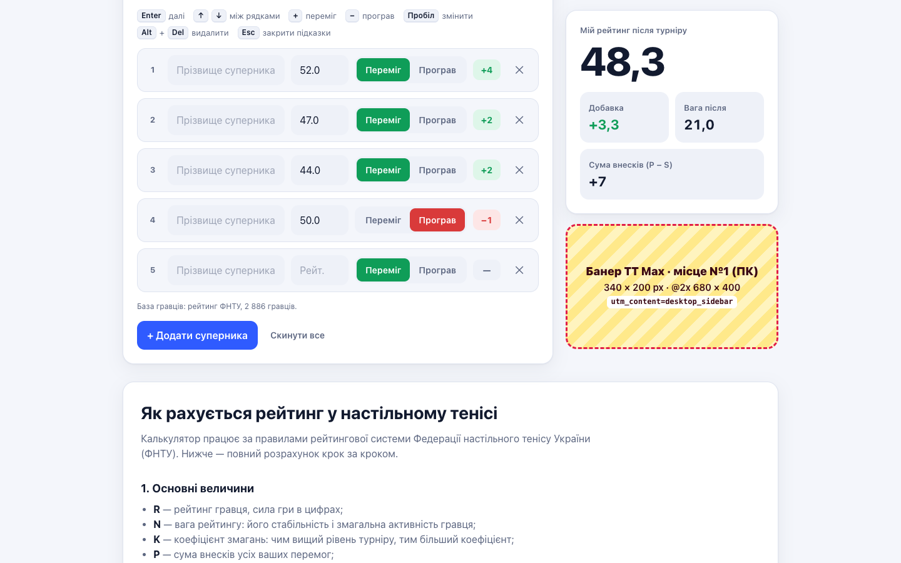
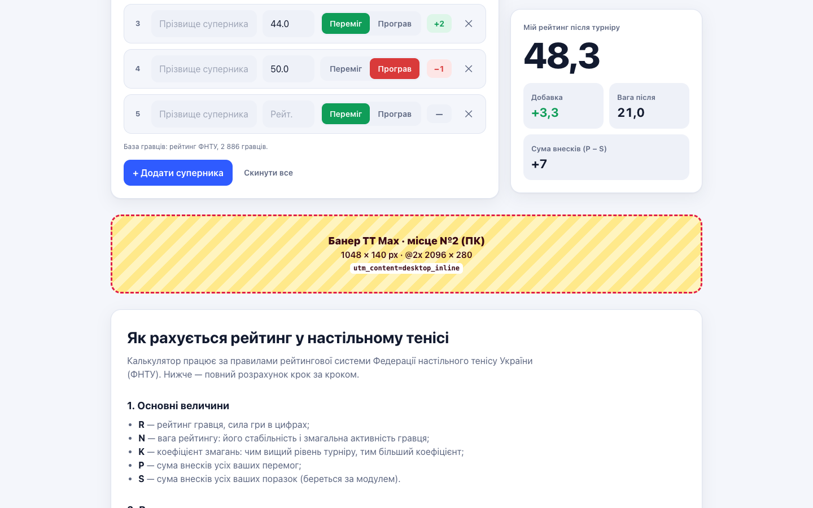
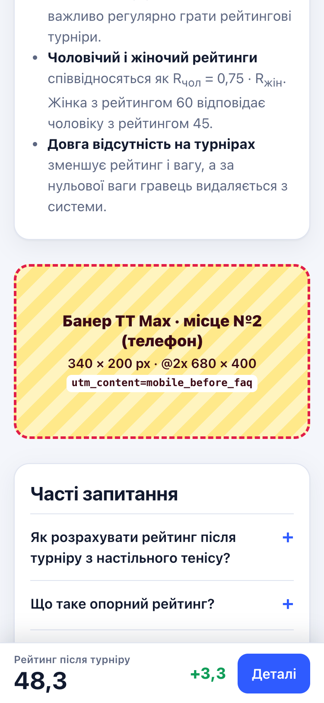

# Партнерство з fntu-rating.com.ua

Пакет для вебмайстра сайту «Калькулятор рейтингу ФНТУ»: банер TT Max з UTM-мітками, блок «про нас»
на головній і окрема сторінка про магазин.

**Статус (27.11.2026):** частина 1 — сайт, місця для банера, UTM-схема. Тексти, код і розмітка —
частина 2, пакет для передачі — частина 3.

## Що за сайт (перевірено 27.11.2026)

| | |
|---|---|
| Що це | Незалежний онлайн-калькулятор рейтингу ФНТУ. У своєму FAQ сайт прямо пише, що **не є офіційним сервісом ФНТУ** |
| Сторінки | Одна: у `sitemap.xml` лише головна (`lastmod` 2026-11-24). Окремих розділів «рейтинг», «гравець», «турніри» немає |
| Технології | Статичний HTML на GitHub Pages (`server: GitHub.com`): `index.html`, `style.css`, `app.js`, `calculator.js`, `players.js`. **CMS немає** — правки вносяться у файли репозиторію; `<script type="application/ld+json">` ніхто не виріже, плагінів, що дописують `nofollow`, немає |
| Мова | Лише українська (`lang="uk"`, hreflang `uk` + `x-default`). RU-версії немає |
| Тема | Світла й темна (за налаштуванням системи) |
| Розмітка | JSON-LD `@graph`: `WebApplication` (`#app`), `WebSite` (`#website`), `FAQPage` |
| Реклама | Місць під банери чи спонсорів немає. Лічильників аналітики в HTML немає |
| База | 2 886 гравців з рейтингу ФНТУ, оновлюється щодня |

Верстка: контейнер 1080 px (контент 1048 px). На ПК — дві колонки: форма 688 px і картка результату
340 px (липка, `top: 16px`, висота ≈326 px). До 860 px — одна колонка і фіксована нижня панель
з результатом (з'являється, коли картка результату поза екраном). До 640 px — менші відступи.

Скриншоти сайту як є: [ПК 1440](screenshots/live-1440.png), [телефон 375](screenshots/live-375.png).

## Місця для банера

На скриншотах місце позначене жовтою смугастою плашкою з розміром і `utm_content`.

### ПК (ширина > 860 px)

| | Місце | Розмір | `utm_content` |
|---|---|---|---|
| **№1, рекомендую** | Права колонка, під карткою «Мій рейтинг після турніру», липке разом із нею | 340 × 200 (файл 680 × 400) | `desktop_sidebar` |
| №2 | На всю ширину між калькулятором і статтею «Як рахується рейтинг» | 1048 × 140 (файл 2096 × 280) | `desktop_inline` |

**Чому №1.** Після кожного введеного матчу погляд іде на результат. Під карткою результату ≈800 px
порожнього місця, поки заповнюється ліва колонка (≈1160 px). Банер видно весь час роботи
з калькулятором, він не перекриває рейтинг і не зсуває форму. Висота стовпчика
326 + 16 + 200 = 542 px — вміщується навіть на ноутбуці 1366 × 768.





**№2** — тихіше місце: його бачать ті, хто гортає до формул. Мінус: посилання «Як рахується
рейтинг ↓» у шапці перескакує одразу до статті, і банер лишається над екраном.



### Телефон і планшет (ширина ≤ 860 px)

| | Місце | Розмір | `utm_content` |
|---|---|---|---|
| **№1, рекомендую** | Одразу після картки результату, у потоці сторінки | файл 680 × 400, тягнеться на ширину екрана (343 × 202 на 375 px), не ширше 480 px | `mobile_after_result` |
| №2 | Між статтею «Як рахується рейтинг» і «Часті запитання» | той самий файл | `mobile_before_faq` |

**Чому №1.** Кнопка «Деталі» на нижній панелі прокручує картку результату в центр екрана — банер
під нею потрапляє в кадр. Панель у цей момент схована (вона з'являється, лише коли картка
результату поза екраном), тож банер нічим не перекритий. Ні липкості, ні спливаючих вікон.




**Не пропонуємо:** шапку (на телефоні відсуне калькулятор униз); місце між «Мої дані»
і «Мої суперники» (розриває форму); між формою і результатом (відсуне результат); липкі
й спливаючі блоки (на телефоні вже є своя фіксована панель).

### Файли банера

- **A, картка 340 × 200** — для ПК №1, телефону №1 і №2. Файл 680 × 400 (@2x), PNG або WebP,
  до 80 КБ. Кути заокруглює CSS (18 px): текст і лого — не ближче 16 px до краю. Сайт має світлу
  й темну тему, тому банер — на власному суцільному фоні, щоб читався і на `#f4f6fb`, і на `#0c111f`.
- **B, смуга 1048 × 140** — лише для ПК №2. Файл 2096 × 280 (@2x).

Файл краще покласти в репозиторій партнера (без запитів до чужих доменів). Посилання —
`rel="sponsored noopener"`, `target="_blank"`, щоб калькулятор лишився відкритим.
**Не додавати `noreferrer`**: він ховає домен-джерело.

## UTM-схема

| Параметр | Значення |
|---|---|
| `utm_source` | `fntu-rating` |
| `utm_medium` | `banner` |
| `utm_campaign` | `fntu_partner` |
| `utm_content` | місце і пристрій: `desktop_sidebar`, `desktop_inline`, `mobile_after_result`, `mobile_before_faq` |

Готові посилання:

```
https://ttmax.com.ua/ua?utm_source=fntu-rating&utm_medium=banner&utm_campaign=fntu_partner&utm_content=desktop_sidebar
https://ttmax.com.ua/ua?utm_source=fntu-rating&utm_medium=banner&utm_campaign=fntu_partner&utm_content=desktop_inline
https://ttmax.com.ua/ua?utm_source=fntu-rating&utm_medium=banner&utm_campaign=fntu_partner&utm_content=mobile_after_result
https://ttmax.com.ua/ua?utm_source=fntu-rating&utm_medium=banner&utm_campaign=fntu_partner&utm_content=mobile_before_faq
```

Текстові посилання (блок «про нас», окрема сторінка) — **без UTM**: це звичайні посилання, у PostHog
вони потрапляють у канал Referral за доменом `fntu-rating.com.ua`.

**Канал у PostHog перевірено 27.11.2026** службовою сесією (`&ttmax_internal=1`, подія з
`internal = true` — фільтр тестових акаунтів її прибирає): `utm_medium=banner` → канал **Display**.
У замовленнях і заявках (CRM, Telegram) джерело видно
як `fntu-rating / banner / fntu_partner`.

### Посадкова сторінка

`https://ttmax.com.ua/ua` — головна (корінь `https://ttmax.com.ua/` веде на неї редиректом 308).
Перевірено 27.11.2026: посилання банера з `&ttmax_internal=1` → **200** без редиректів,
`canonical` = `https://ttmax.com.ua/ua` (без UTM), `robots: index, follow`. Якщо банер буде
про накладки, посадкову можна змінити на `https://ttmax.com.ua/ua/nakladki` з тими самими мітками.

### Як рахувати трафік

PostHog, проєкт 315663 → SQL. Без службових візитів власника:

```sql
SELECT
  if(session.$entry_utm_source = 'fntu-rating',
     concat('банер · ', session.$entry_utm_content),
     'текстові посилання') AS dzherelo,
  uniq($session_id) AS sesii,
  uniq(person_id) AS lyudy,
  countIf(event = 'purchase') AS pokupky,
  countIf(event = 'lead_created') AS zayavky
FROM events
WHERE timestamp >= toDateTime('2026-12-01')   -- дата розміщення
  AND properties.internal IS NULL
  AND (session.$entry_utm_source = 'fntu-rating'
       OR session.$entry_referring_domain = 'fntu-rating.com.ua')
GROUP BY dzherelo
ORDER BY sesii DESC
```

Запит перевірено на службовій сесії 27.11.2026 (рядок `банер · desktop_sidebar`).
