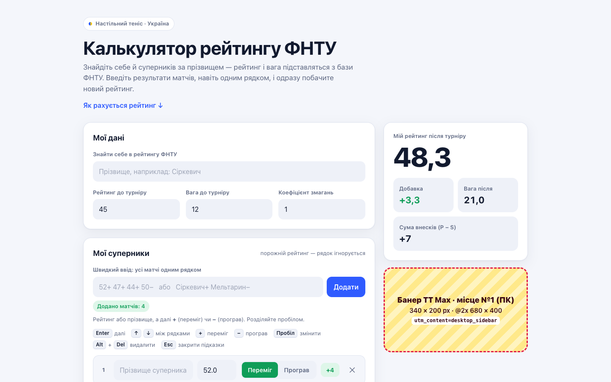
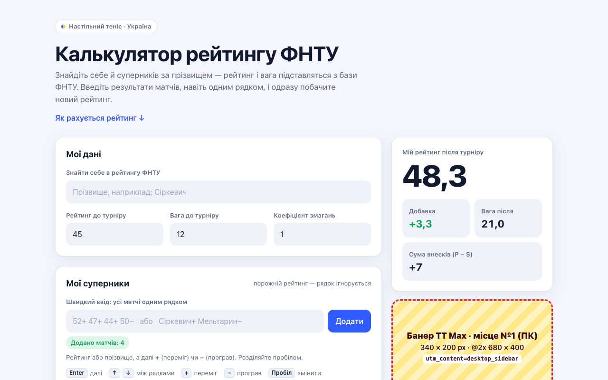
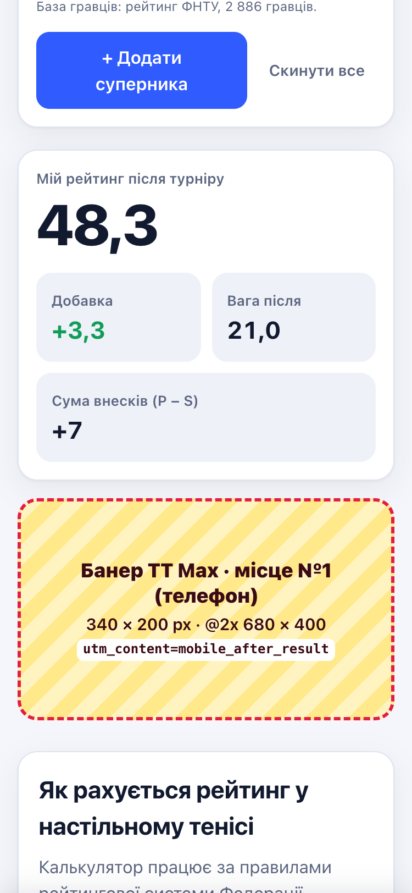
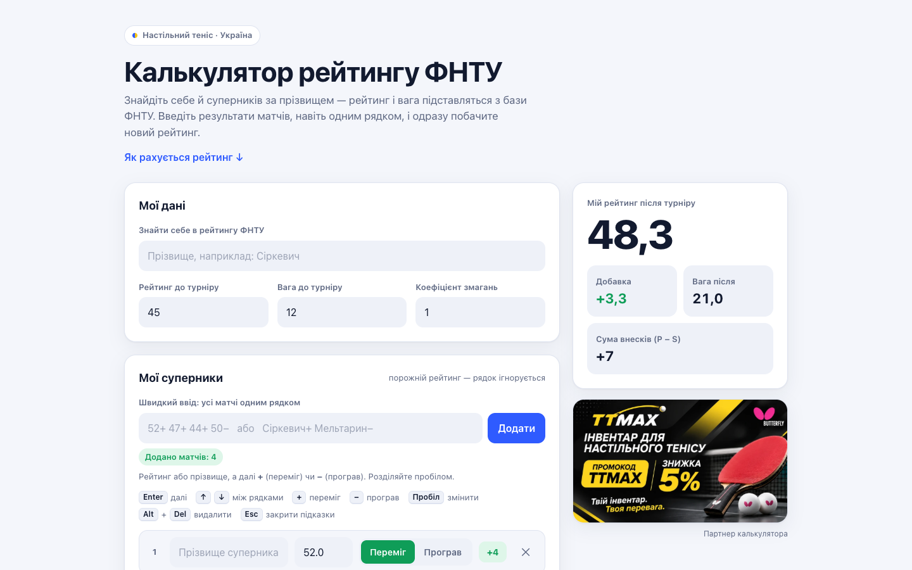
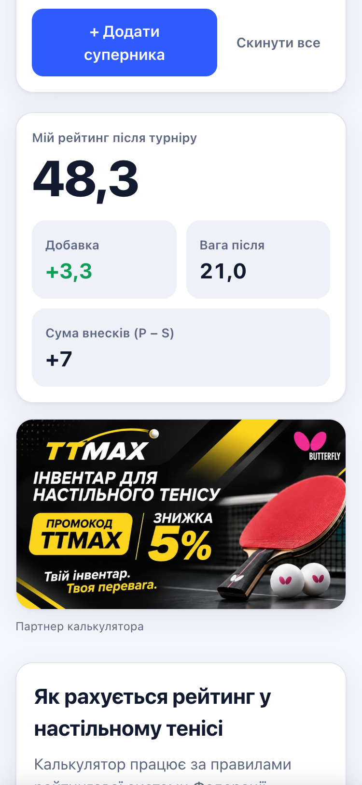
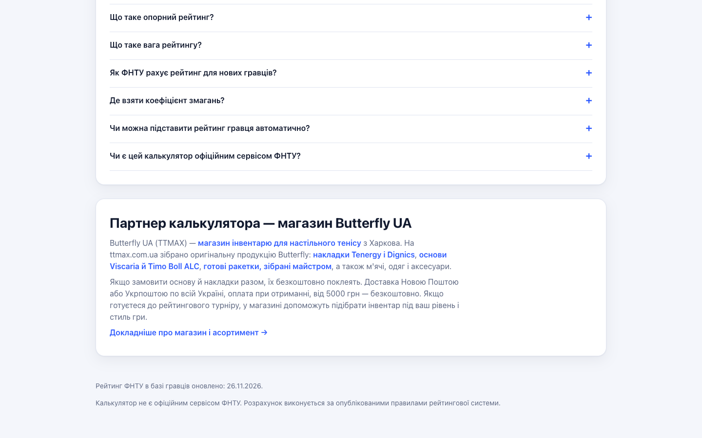
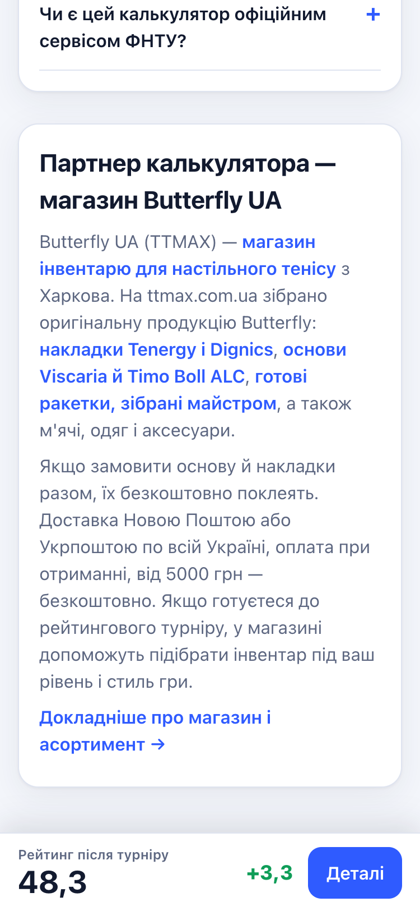
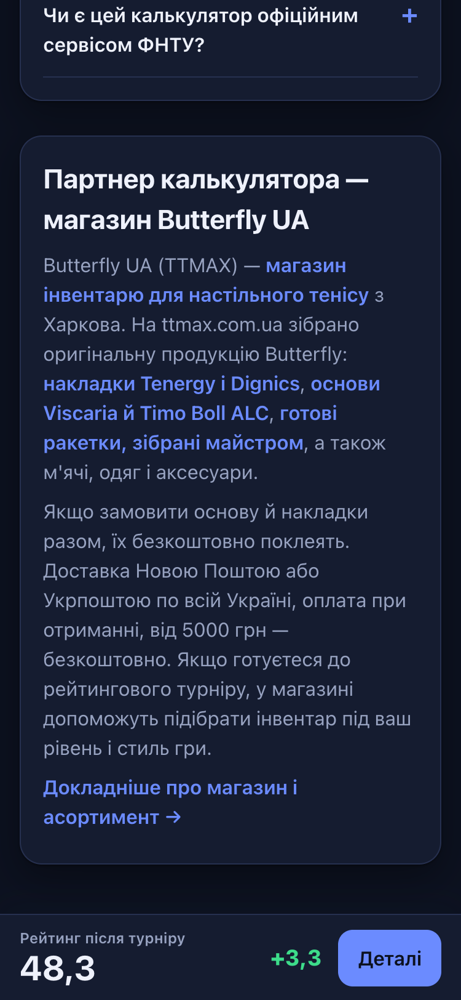
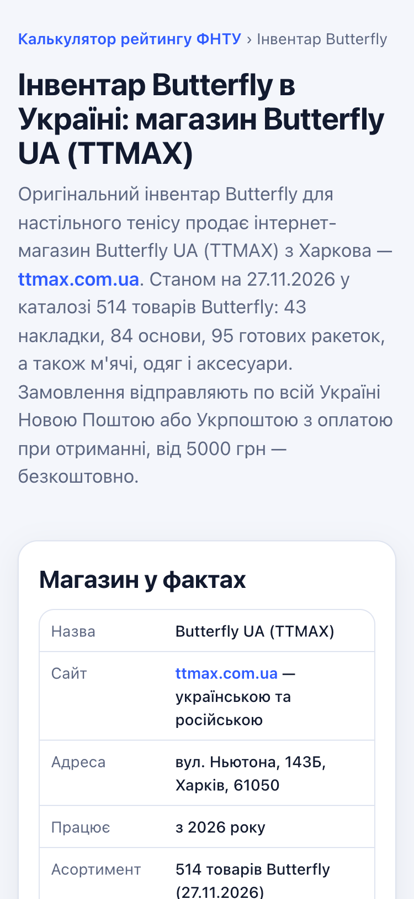

# Партнерство з fntu-rating.com.ua

Пакет для вебмайстра сайту «Калькулятор рейтингу ФНТУ»: банер Butterfly UA (TTMAX) з UTM-мітками,
блок «Партнер калькулятора» на головній і окрема сторінка про магазин.

**Статус (27.11.2026):** пакет готовий, на сайті партнера ще нічого не розміщено.
Чекаємо від власника файл банера (перевірити розмір, вагу й читабельність).

**Для пересилання партнеру** — сторінка з макетами й кодом з кнопками копіювання:
https://claude.ai/artifact/VtiSgTo3fcNRjr18rh11Et (приватна: відкрити доступ через меню Share).
Код на ній зібрано з файлів цієї теки; змінили файл — оновіть і сторінку.

| Файл | Що в ньому |
|---|---|
| [banner.html](banner.html) | Код банера: місце №1 (ПК + телефон), альтернативи №2, стилі |
| [homepage-block.html](homepage-block.html) | Блок «Партнер калькулятора» для головної, стилі, JSON-LD для `<head>` |
| [page.html](page.html) | Готова сторінка `https://fntu-rating.com.ua/inventar-butterfly/` з JSON-LD |
| [screenshots/](screenshots/) | Сайт як є, позначені місця, вигляд після вставки |

## Рішення власника (27.11.2026)

- **Розміщує вебмайстер партнера сам** — йому передаємо файли й інструкцію нижче.
- **Розміщення безкоштовне / обмін.** Текстові посилання (блок і окрема сторінка) — звичайні,
  dofollow. Банер — `rel="sponsored"`: це реклама. Ризик, озвучений власнику: якщо посилання
  з вагою отримано за гроші, товар чи «посилання в обмін на посилання», Google вважає це схемою
  посилань — може не врахувати посилання або дати ручну санкцію. Для одного тематичного партнера
  ймовірність мала; рішення — за власником.
- **Банер готовий у власника.** Код розраховано на файл 680 × 400 (`ttmax-banner.png`); інші
  пропорції — поміняти `width`/`height` у ``.
- **Окрема сторінка — на fntu-rating**, адреса `/inventar-butterfly/`.

## Що за сайт (перевірено 27.11.2026)

| | |
|---|---|
| Що це | Незалежний онлайн-калькулятор рейтингу ФНТУ. У своєму FAQ сайт прямо пише, що **не є офіційним сервісом ФНТУ** |
| Сторінки | Одна: у `sitemap.xml` лише головна (`lastmod` 2026-11-24). Окремих розділів «рейтинг», «гравець», «турніри» немає |
| Технології | Статичний HTML на GitHub Pages (`server: GitHub.com`): `index.html`, `style.css`, `app.js`, `calculator.js`, `players.js`. **CMS немає** — правки вносяться у файли репозиторію; `<script type="application/ld+json">` ніхто не виріже, плагінів, що дописують `nofollow`, немає |
| Мова | Лише українська (`lang="uk"`, hreflang `uk` + `x-default`). RU-версії немає |
| Тема | Світла й темна (за налаштуванням системи) |
| Розмітка | JSON-LD `@graph`: `WebApplication` (`#app`), `WebSite` (`#website`), `FAQPage` |
| Реклама | Місць під банери чи спонсорів немає. Лічильників аналітики в HTML немає |
| База | 2 886 гравців з рейтингу ФНТУ, оновлюється щодня |

Верстка: контейнер 1080 px (контент 1048 px). На ПК — дві колонки: форма 688 px і картка результату
340 px (липка, `top: 16px`, висота ≈326 px). До 860 px — одна колонка і фіксована нижня панель
з результатом (з'являється, коли картка результату поза екраном). До 640 px — менші відступи.

Скриншоти сайту як є: [ПК 1440](screenshots/live-1440.png), [телефон 375](screenshots/live-375.png).

## Місця для банера

На скриншотах місце позначене жовтою смугастою плашкою з розміром і `utm_content`.

### ПК (ширина > 860 px)

| | Місце | Розмір | `utm_content` |
|---|---|---|---|
| **№1, рекомендую** | Права колонка, під карткою «Мій рейтинг після турніру», липке разом із нею | 340 × 200 (файл 680 × 400) | `desktop_sidebar` |
| №2 | На всю ширину між калькулятором і статтею «Як рахується рейтинг» | 1048 × 140 (файл 2096 × 280) | `desktop_inline` |

**Чому №1.** Після кожного введеного матчу погляд іде на результат. Під карткою результату ≈800 px
порожнього місця, поки заповнюється ліва колонка (≈1160 px). Банер видно весь час роботи
з калькулятором, він не перекриває рейтинг і не зсуває форму. Висота стовпчика
326 + 16 + 200 = 542 px — вміщується навіть на ноутбуці 1366 × 768.





**№2** — тихіше місце: його бачать ті, хто гортає до формул. Мінус: посилання «Як рахується
рейтинг ↓» у шапці перескакує одразу до статті, і банер лишається над екраном.


### Телефон і планшет (ширина ≤ 860 px)

| | Місце | Розмір | `utm_content` |
|---|---|---|---|
| **№1, рекомендую** | Одразу після картки результату, у потоці сторінки | файл 680 × 400, тягнеться на ширину екрана (343 × 202 на 375 px), не ширше 480 px | `mobile_after_result` |
| №2 | Між статтею «Як рахується рейтинг» і «Часті запитання» | той самий файл | `mobile_before_faq` |

**Чому №1.** Кнопка «Деталі» на нижній панелі прокручує картку результату в центр екрана — банер
під нею потрапляє в кадр. Панель у цей момент схована (вона з'являється, лише коли картка
результату поза екраном), тож банер нічим не перекритий. Ні липкості, ні спливаючих вікон.




**Не пропонуємо:** шапку (на телефоні відсуне калькулятор униз); місце між «Мої дані»
і «Мої суперники» (розриває форму); між формою і результатом (відсуне результат); липкі
й спливаючі блоки (на телефоні вже є своя фіксована панель).

### Файли банера

- **A, картка 340 × 200** — для ПК №1, телефону №1 і №2. Файл 680 × 400 (@2x), PNG або WebP,
  до 80 КБ. Кути заокруглює CSS (18 px): текст і лого — не ближче 16 px до краю. Сайт має світлу
  й темну тему, тому банер — на власному суцільному фоні, щоб читався і на `#f4f6fb`, і на `#0c111f`.
- **B, смуга 1048 × 140** — лише для ПК №2. Файл 2096 × 280 (@2x).

Файл краще покласти в репозиторій партнера (без запитів до чужих доменів). Посилання —
`rel="sponsored noopener"`, `target="_blank"`, щоб калькулятор лишився відкритим.
**Не додавати `noreferrer`**: він ховає домен-джерело.

## UTM-схема

| Параметр | Значення |
|---|---|
| `utm_source` | `fntu-rating` |
| `utm_medium` | `banner` |
| `utm_campaign` | `fntu_partner` |
| `utm_content` | місце і пристрій: `desktop_sidebar`, `desktop_inline`, `mobile_after_result`, `mobile_before_faq` |

Готові посилання:

```
https://ttmax.com.ua/ua?utm_source=fntu-rating&utm_medium=banner&utm_campaign=fntu_partner&utm_content=desktop_sidebar
https://ttmax.com.ua/ua?utm_source=fntu-rating&utm_medium=banner&utm_campaign=fntu_partner&utm_content=desktop_inline
https://ttmax.com.ua/ua?utm_source=fntu-rating&utm_medium=banner&utm_campaign=fntu_partner&utm_content=mobile_after_result
https://ttmax.com.ua/ua?utm_source=fntu-rating&utm_medium=banner&utm_campaign=fntu_partner&utm_content=mobile_before_faq
```

Текстові посилання (блок «про нас», окрема сторінка) — **без UTM**: це звичайні посилання, у PostHog
вони потрапляють у канал Referral за доменом `fntu-rating.com.ua`.

**Канал у PostHog перевірено 27.11.2026** службовою сесією (`&ttmax_internal=1`, подія з
`internal = true` — фільтр тестових акаунтів її прибирає): `utm_medium=banner` → канал **Display**.
У замовленнях і заявках (CRM, Telegram) джерело видно
як `fntu-rating / banner / fntu_partner`.

### Посадкова сторінка

`https://ttmax.com.ua/ua` — головна (корінь `https://ttmax.com.ua/` веде на неї редиректом 308).
Перевірено 27.11.2026: посилання банера з `&ttmax_internal=1` → **200** без редиректів,
`canonical` = `https://ttmax.com.ua/ua` (без UTM), `robots: index, follow`. Якщо банер буде
про накладки, посадкову можна змінити на `https://ttmax.com.ua/ua/nakladki` з тими самими мітками.

### Як рахувати трафік

PostHog, проєкт 315663 → SQL. Без службових візитів власника:

```sql
SELECT
  if(session.$entry_utm_source = 'fntu-rating',
     concat('банер · ', session.$entry_utm_content),
     'текстові посилання') AS dzherelo,
  uniq($session_id) AS sesii,
  uniq(person_id) AS lyudy,
  countIf(event = 'purchase') AS pokupky,
  countIf(event = 'lead_created') AS zayavky
FROM events
WHERE timestamp >= toDateTime('2026-12-01')   -- дата розміщення
  AND properties.internal IS NULL
  AND (session.$entry_utm_source = 'fntu-rating'
       OR session.$entry_referring_domain = 'fntu-rating.com.ua')
GROUP BY dzherelo
ORDER BY sesii DESC
```

Запит перевірено на службовій сесії 27.11.2026 (рядок `банер · desktop_sidebar`).

## Інструкція вебмайстру

Сайт статичний (GitHub Pages), тож усе — правки у файлах репозиторію. Код з пакета перевірено
на копії сайту 27.11.2026: ПК 1440 і 1280 px, телефон 360 і 375 px, світла й темна тема,
горизонтальної прокрутки немає.

### Крок 1. Банер ([banner.html](banner.html))

1. Покласти файл банера `ttmax-banner.png` (680 × 400) у корінь репозиторію.
2. У `index.html` обгорнути `<aside class="card result" id="result" …>…</aside>` у `<div class="side">`
   і одразу після `</aside>` вставити два посилання й підпис «Партнер калькулятора» з `banner.html`.
3. Стилі з `banner.html` — у кінець `style.css`.

На ПК банер стоїть під результатом і прокручується разом з ним, на телефоні — одразу після картки
результату (на скриншотах — зразок замість справжнього банера):




Якщо місце №1 не підходить — альтернативи №2 у тому ж файлі (смуга 2096 × 280 для ПК,
картка між статтею і FAQ для телефона).

### Крок 2. Блок «Партнер калькулятора» ([homepage-block.html](homepage-block.html))

- **Де:** наприкінці `<main>`, після секції «Часті запитання». Це основний вміст сторінки, а не
  підвал, і блок не заважає калькулятору й статті з формулами.
- **Текст:** 81 слово українською (RU-версії сайту немає).
- **Посилання (4, без UTM, dofollow):** «магазин інвентарю для настільного тенісу» → `/ua`,
  «накладки Tenergy і Dignics» → `/ua/nakladki`, «основи Viscaria й Timo Boll ALC» → `/ua/osnovaniya`,
  «готові ракетки, зібрані майстром» → `/ua/rakety`. П'яте — внутрішнє, на нову сторінку партнера.
- **Розмітка:** окремий `<script type="application/ld+json">` у `<head>` — `WebPage` головної
  згадує (`mentions`) магазин `https://ttmax.com.ua/#business`. Наявний JSON-LD партнера не змінюється.
- CMS на сайті немає, тож `nofollow` ніхто не допише. Якщо сайт переїде на WordPress чи іншу CMS —
  перевірити, що SEO-плагін не ставить `nofollow` на зовнішні посилання.





### Крок 3. Окрема сторінка ([page.html](page.html))

1. Створити файл `inventar-butterfly/index.html` з вмісту `page.html` — адреса
   `https://fntu-rating.com.ua/inventar-butterfly/`. Стилі беруться з `/style.css` сайту.
2. У JSON-LD замінити `2026-11-27` (`datePublished`, `dateModified`) на дату публікації.
3. Додати сторінку в `sitemap.xml`:

   ```xml
   <url>
     <loc>https://fntu-rating.com.ua/inventar-butterfly/</loc>
     <lastmod>2026-11-27</lastmod>
     <changefreq>monthly</changefreq>
     <priority>0.6</priority>
   </url>
   ```

4. Посилання з головної дає блок із кроку 2 («Докладніше про магазин і асортимент →»): без нього
   сторінка була б сиротою.

Що на сторінці: на початку пряма відповідь у трьох реченнях; таблиця фактів; каталог із кількістю
товарів на 27.11.2026 і посиланнями на 8 категорій і 9 хабів; 7 довідників магазину; вимоги правил
ITTF 2026 до ракетки й м'яча (джерело — Laws of Table Tennis 2026–27); FAQ з 5 питань; підпис
«Партнерський матеріал». Усього 27 посилань на ttmax.com.ua, усі без `rel` і UTM.
Розмітка: `WebPage` (`about` → `#business`), `BreadcrumbList`, `Store` `#business`, `Organization`
`#org`, `WebSite` `#website`, `FAQPage`. `AggregateRating` і `Review` немає.




Повністю: [page-desktop-1440-full.png](screenshots/page-desktop-1440-full.png).

### Звідки факти

Усе про магазин — з репозиторію й живого сайту 27.11.2026: `src/config/site.ts` (назва, адреса,
телефон, пошта, графік, рік), `src/data/info.ts` (про нас, доставка, оплата), `src/data/legal.ts`
(повернення 14 днів, «лише оригінальна продукція»), `src/config/delivery.ts` (терміни),
`site_settings` у Supabase (безкоштовна доставка від 5000 грн), поклейка — рішення власника
24.11.2026 (`src/i18n/messages/ua.ts`). Кількість товарів — `ItemList.numberOfItems` на сторінках
категорій. «Офіційний дилер» і «партнер ФНТУ» **не пишемо**: це ніде не підтверджено.
Назви й `url` вузлів розмітки — як у JSON-LD ttmax.com.ua (`name` «Butterfly UA», `alternateName`
«TTMAX»). Усі 26 адрес ttmax.com.ua з пакета 27.11.2026 віддають 200 і canonical на себе.

## Чек-лист після розміщення

1. **Посилання без nofollow.** На головній — 4 текстові посилання без `rel` і 2 посилання банера
   з `rel="sponsored noopener"` та UTM:

   ```bash
   curl -s https://fntu-rating.com.ua/ | grep -o '<a [^>]*ttmax\.com\.ua[^>]*>'
   ```

   На окремій сторінці жодне посилання на ttmax не має `rel` (очікуємо `0`):

   ```bash
   curl -s https://fntu-rating.com.ua/inventar-butterfly/ | grep -o '<a [^>]*ttmax\.com\.ua[^>]*>' | grep -c 'rel='
   ```

   І сторінки не закриті від індексації чи переходу за посиланнями:

   ```bash
   curl -sI https://fntu-rating.com.ua/inventar-butterfly/ | grep -iE '^HTTP|x-robots-tag'
   curl -s https://fntu-rating.com.ua/inventar-butterfly/ | grep -oE '<meta name="robots"[^>]*>|<link rel="canonical"[^>]*>'
   ```

2. **JSON-LD валідний.** Обидві адреси — у [validator.schema.org](https://validator.schema.org/)
   (без помилок; на сторінці — WebPage, BreadcrumbList, Store, Organization, WebSite, FAQPage)
   і в [Rich Results Test](https://search.google.com/test/rich-results) (очікуємо «Навігаційні
   ланцюжки»; FAQ Google зараз показує лише для державних і медичних сайтів — це не помилка).
   Швидко з терміналу — блоки парсяться і які в них типи:

   ```bash
   curl -s https://fntu-rating.com.ua/inventar-butterfly/ | node -e 'let s="";process.stdin.on("data",d=>s+=d).on("end",()=>{for(const m of s.matchAll(/<script type="application\/ld\+json">([\s\S]*?)<\/script>/g)){const j=JSON.parse(m[1]);console.log((j["@graph"]||[j]).map(n=>n["@type"]).join(", "))}})'
   ```

3. **Сторінка індексується.** Є в sitemap:

   ```bash
   curl -s https://fntu-rating.com.ua/sitemap.xml | grep inventar-butterfly
   ```

   Партнер може прискорити: Search Console → «Перевірка URL» → «Надіслати запит на індексування».
   Через 1–2 тижні: пошук `site:fntu-rating.com.ua/inventar-butterfly`. Через кілька тижнів
   fntu-rating.com.ua має з'явитися в нашому Search Console → «Посилання» → «Зовнішні посилання».

4. **Трафік.** Запит із розділу «Як рахувати трафік» — від дати розміщення. Банер — рядки
   `банер · <місце>`, текстові посилання — `текстові посилання`.
